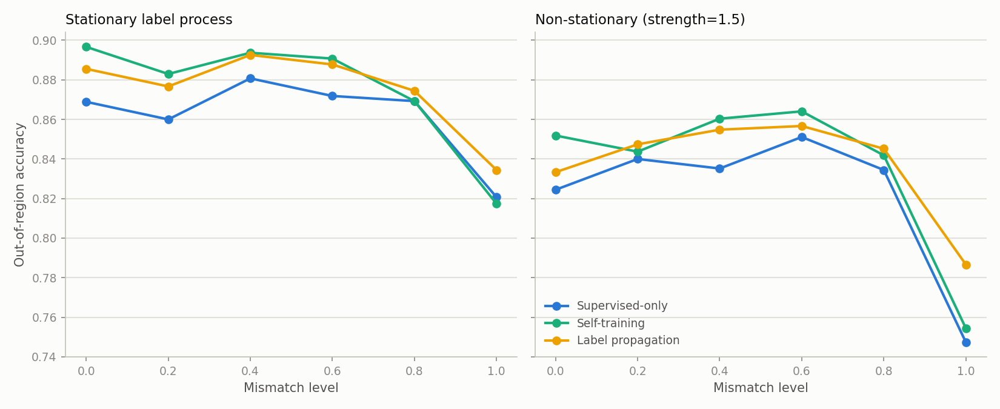

<div align="center">


## Semi-Supervised Learning under Spatial Distribution Mismatch

[](https://www.python.org/)
[](https://numpy.org/)
[](https://scipy.org/)
[](https://scikit-learn.org/)
[](https://pandas.pydata.org/)
[](https://matplotlib.org/)
[](https://jupyter.org/)
[](https://www.latex-project.org/)
[](https://wilds.stanford.edu/)

</div>

---

## Overview

Standard SSL assumes labelled and unlabelled data share a common marginal
distribution. Spatial dependence alone doesn't violate this — labelled and
unlabelled locations are typically draws from the same underlying spatial
process. What violates it is the **sampling mechanism**: spatially biased or
preferential site selection makes the marginals genuinely diverge. We treat
marginal mismatch, spatial autocorrelation, and spatial non-stationarity as
three distinct mechanisms, and ask how mismatch degrades SSL, whether the
cluster, manifold, and low-density-separation assumptions survive it, and how
the resulting failure can be diagnosed.

Using a controlled synthetic framework alongside PovertyMap-WILDS, California
housing, socio-economic, and US air quality data, we vary mismatch severity
while independently controlling for autocorrelation and non-stationarity,
across a ten-method comparison, a distribution-aware mitigation framework, and
calibration/divergence diagnostics (a segmented-regression changepoint
analysis and a kernel-weighted local divergence estimator).

SSL performance doesn't degrade gradually — it shows a **threshold-like
breakdown** around α ≈ 0.71–0.77. Spatial non-stationarity degrades
performance independently of marginal mismatch, and affected models become
increasingly **overconfident** precisely where they are most wrong.

<p align="center">
  
</p>

<!-- ## Repository structure

```
SSL/
├── src/ssl_spatial/    Core package: data loaders, models, metrics, experiment runners
├── notebooks/          Walkthroughs for each experiment
├── configs/            One YAML sweep definition per experiment (see table below)
├── results/            One CSV per config
├── data/               Downloaded dataset caches (gitignored)
├── figures/            fig1-19, generated by scripts/regenerate_figures.py
└── requirements.txt
``` -->

## Methods compared

| Family | Methods | Notes |
|---|---|---|
| Baselines | Supervised-only, Self-training, Label propagation | Main-text focus; operationalise no/cluster/manifold assumptions |
| Distribution-aware | Re-weighted self-training, full 3-component framework | Density-ratio re-weighting + spatial weighting + adaptive pseudo-labelling |
| Consistency-based | Mean Teacher, FixMatch | Gaussian-noise perturbation in place of image augmentation |
| Graph-based | GCN, spatial-kernel GCN | Transductive, $k$-NN or Gaussian-weighted spatial graph |
| Spatially explicit | GNNWR | Geography-only, no covariate fallback |
| Geostatistical | Geostatistical SSL | Conditional-simulation pseudo-labelling, following Fouedjio & Talebi (2022) |

## Datasets

| Dataset | Domain | Geographic unit | Source |
|---|---|---|---|
| Synthetic generator | Controlled | Continuous 2D domain | `src/ssl_spatial/data/synthetic.py` |
| PovertyMap-WILDS | Satellite poverty mapping | Country (official split) | Koh et al. (2021), WILDS |
| California Housing | Housing/built environment | County (58) | Pace & Barry (1997), `sklearn` |
| USDA county data | Socio-economic | County (3,130) | USDA Economic Research Service |
| EPA AQS PM$_{2.5}$ | Environmental monitoring | State | US EPA Air Quality System |

<!-- ## Installation

```bash
git clone https://github.com/Wiredu2020/Distributional-Mismatch-in-Spatial-SSL-Application.git
cd Distributional-Mismatch-in-Spatial-SSL-Application
pip install -r requirements.txt
```

Requires Python 3.9+. Core dependencies: `numpy`, `scipy`, `scikit-learn`,
`pandas`, `matplotlib`, `pyyaml`, `python-docx`, `wilds`, `requests`, `jupyter`.

## Reproducing the results

**Synthetic controlled experiment** (324 runs, ~2 minutes on a laptop CPU):

```bash
PYTHONPATH=src python -m ssl_spatial.experiments.controlled_experiment configs/controlled_experiment.yaml
PYTHONPATH=src python -m ssl_spatial.experiments.plot_results
```

**PovertyMap-WILDS benchmark** (after downloading images once — see
`notebooks/benchmark.ipynb` §3):

```bash
PYTHONPATH=src python -m ssl_spatial.experiments.wilds_benchmark configs/wilds_benchmark.yaml
```

**Real-world datasets** (housing, socio-economic, air quality):

```bash
PYTHONPATH=src python -m ssl_spatial.experiments.real_world_benchmark configs/housing_benchmark.yaml
PYTHONPATH=src python -m ssl_spatial.experiments.real_world_benchmark configs/socioeconomic_benchmark.yaml
PYTHONPATH=src python -m ssl_spatial.experiments.real_world_benchmark configs/air_quality_benchmark.yaml
```

**Distribution-aware framework (H4)**:

```bash
PYTHONPATH=src python -m ssl_spatial.experiments.controlled_experiment configs/controlled_experiment_h4.yaml
PYTHONPATH=src python -m ssl_spatial.experiments.wilds_benchmark configs/wilds_benchmark_h4.yaml
```

**Ten-method comparison** across all five datasets:

```bash
PYTHONPATH=src python -m ssl_spatial.experiments.spatial_methods_comparison configs/spatial_methods_comparison.yaml
```

**Changepoint analysis** (20-seed re-run + segmented regression):

```bash
PYTHONPATH=src python -m ssl_spatial.experiments.controlled_experiment configs/controlled_experiment_sensitivity.yaml
PYTHONPATH=src python -m ssl_spatial.experiments.changepoint_analysis
```

**Localised MMD validation** (fixed-grid vs. kernel-weighted):

```bash
PYTHONPATH=src python -m ssl_spatial.experiments.localized_mmd_analysis
```
 -->


<!-- ## Citation

If you use this code or reference these findings, please cite: -->

<!-- ```bibtex
@unpublished{ssl_spatial_mismatch,
  title  = {When Unlabelled Data Misleads: Semi-Supervised Learning under
            Spatial Distribution Mismatch},
  note   = {Code available at
            \url{https://github.com/Wiredu2020/Distributional-Mismatch-in-Spatial-SSL-Application}}
}
``` -->

Repository: https://github.com/Wiredu2020/Distributional-Mismatch-in-Spatial-SSL-Application

## What is covered


The experiments distinguish spatially biased sampling, spatial dependence,
and non-stationarity. They compare prediction and calibration across sampling
severity, evaluate divergence diagnostics, and investigate mitigation and
spatial methods. Synthetic breakpoint estimates are descriptive, not validated
thresholds for deployment. Real-data conclusions depend on the geographic split.


## Repository contents

| Path | Purpose |
| --- | --- |
| `src/ssl_spatial/data/` | Synthetic generator and real-data loaders |
| `src/ssl_spatial/models/` | Classical, neural, spatial, and geostatistical models |
| `src/ssl_spatial/metrics/` | Accuracy, calibration, divergence, bootstrap utilities |
| `src/ssl_spatial/experiments/` | YAML-driven runners and analyses |
| `configs/` | Experiment and smoke-test settings |
| `notebooks/` | Additional walkthroughs |
| `figures/` | Included manuscript figures; some commands overwrite named figures |
| `requirements.txt` | Full unpinned dependency list |
| `docs/` | Data preparation, reproduction, and validation notes |


## Installation

Use Python 3.10 or newer; the code contains modern union type syntax.


## NOTE
The notebooks provide easy implemntations of the analysis performed. For the exact condiguration that establishes the results in this work use the following commands below.

```bash
git clone https://github.com/Wiredu2020/Distributional-Mismatch-in-Spatial-SSL-Application.git
cd Distributional-Mismatch-in-Spatial-SSL-Application
python -m venv .venv
```

Activate it on Linux/macOS:

```bash
source .venv/bin/activate
export PYTHONPATH="$PWD/src"
```

Or in Windows PowerShell:

```powershell
.\.venv\Scripts\Activate.ps1
$env:PYTHONPATH = "$PWD\src"
```

Install the full requirements:

```bash
python -m pip install -r requirements.txt
```

For the synthetic baseline smoke test only, the smaller dependency set is:

```bash
python -m pip install numpy scipy scikit-learn pandas matplotlib pyyaml
```

The full requirements also include PyTorch, GSTools, WILDS, Requests,
OpenPyXL, and `pwlf`. Neural models require PyTorch; the geostatistical method
requires GSTools. The baseline test uses a CPU and does not need a GPU or
external data. Full-run time and memory depend on sample sizes and methods;
no universal laptop runtime is claimed.

For configuration options, output interpretation and worked examples, see
[docs/USER_GUIDE.md](docs/USER_GUIDE.md).

## Quick verification

From the repository root, after setting `PYTHONPATH`:

```bash
python -m ssl_spatial.experiments.controlled_experiment configs/smoke_test.yaml
```

Expected output: `results/smoke_test.csv`, containing nine rows: three methods
at three severities, one seed, one length-scale, and one non-stationarity level.
Reported metrics include `accuracy_out_region`, `f1_out_region`, calibration,
and divergence. This checks execution, not replication of all paper results.

## Reproduce the twenty-seed experiments

These commands match the repository's module and configuration names:

```bash
python -m ssl_spatial.experiments.controlled_experiment configs/controlled_experiment_v2.yaml
python -m ssl_spatial.experiments.localized_mmd_analysis_v2
python -m ssl_spatial.experiments.controlled_experiment configs/controlled_experiment_sensitivity.yaml
python -m ssl_spatial.experiments.changepoint_analysis
```

The main synthetic sweep contains 2,160 fitted models: 6 severities × 3
length-scales × 2 non-stationarity levels × 20 seeds × 3 methods. The original
`controlled_experiment.yaml` is a three-seed, 324-model exploratory version;
use the `_v2` configuration for the main twenty-seed analysis.

Prepare data as described in [docs/DATA.md](docs/DATA.md), then run:

```bash
python -m ssl_spatial.experiments.wilds_benchmark configs/wilds_benchmark_v2.yaml
python -m ssl_spatial.experiments.real_world_benchmark configs/housing_benchmark_v2.yaml
python -m ssl_spatial.experiments.real_world_benchmark configs/socioeconomic_benchmark_v2.yaml
python -m ssl_spatial.experiments.real_world_benchmark configs/air_quality_benchmark_v2.yaml
python -m ssl_spatial.experiments.spatial_methods_comparison configs/spatial_methods_comparison_v2.yaml
python -m ssl_spatial.experiments.h4_ablation_v2 configs/h4_ablation_v2.yaml
python -m ssl_spatial.experiments.neural_da_ssl_v2 configs/neural_da_ssl_v2.yaml
```

See [docs/REPRODUCIBILITY.md](docs/REPRODUCIBILITY.md) for output names,
analysis dependencies, and limits of figure/table reproduction.


## Citation, archive, and reuse

The existing archive is https://doi.org/10.5281/zenodo.23307560 (v1.0.0).


```bibtex
@unpublished{nuakoh_spatial_ssl,
  author = {Nuakoh, Bright Wiredu and Fouedjio, Francky and Bradshaw, Stephen
    and Awuah-Mensah, Yaw Kwaafo and Tan, Wei Hong and Arya, Emet
    and Afrifa-Yamoah, Ebenezer},
  title = {Semi-Supervised Learning under Spatially Biased Sampling},
  year = {2026},
  url = {https://github.com/Wiredu2020/Distributional-Mismatch-in-Spatial-SSL-Application}
}
```

The original software in this repository is licensed under CC-BY-4.0; see
[LICENSE](LICENSE). 

Software contact: Bright Wiredu Nuakoh, bright.wiredu@aims.ac.rw.

This repos is published at https://doi.org/10.5281/zenodo.23307560 (Not always updated, GitHub version is recommended.)
